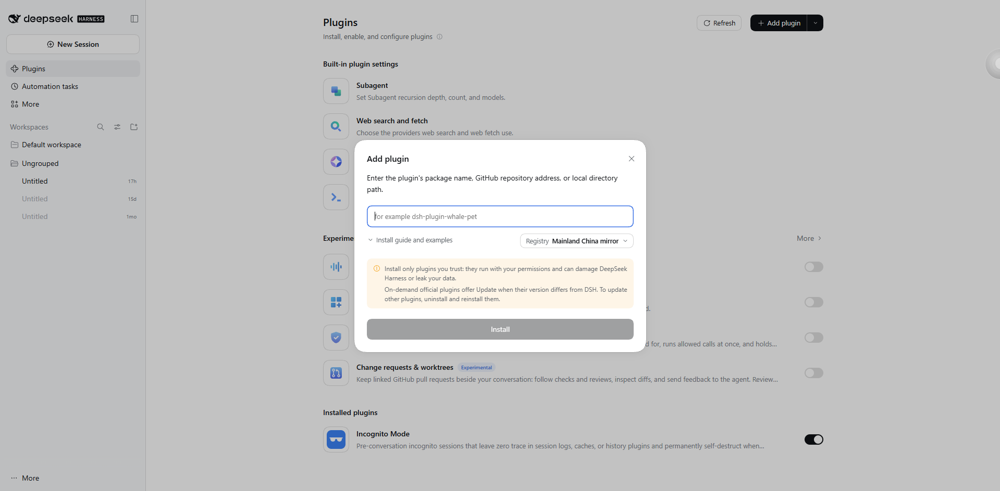
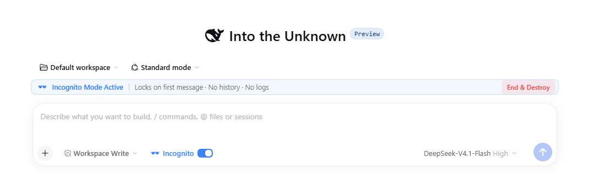

<div align="center">


# Incognito Mode for DeepSeek Harness

**Private, memory-only conversations for DeepSeek Harness (`dsh`).**
Nothing is written to session logs. Nothing shows up in history. Everything is gone the moment you leave.

`@local/dsh-incognito` · Host + Web Client plugin · no changes to dsh core

**English** · [简体中文](README.zh.md)

</div>

---

## Why

Sometimes you just want to ask a quick question without it cluttering your session history or
workspace. Or it's a private conversation, and you don't want it to be found again later. This plugin adds an **Incognito** switch to the DeepSeek Harness Web UI. Turn it
on before you start a conversation, and that conversation:

- 🧠 **lives only in memory**: it is never written to session logs, projection caches or workspace storage
- 🙈 **stays out of history**: hidden from the sidebar, session lists, search and dsh's history/query services
- 💥 **self-destructs**: ending it, switching away or closing the tab deletes it for good, with no way to restore it

> [!IMPORTANT]
> Incognito Mode protects **dsh's own session layer** only. Some other plugins may still read or
> store incognito content, and the model provider, agent tools, your OS and your browser are not
> covered at all. Please read [When it fails](#when-it-fails) before relying on it.

---

## Table of contents

- [Installation](#installation)
- [Usage](#usage)
- [How it works](#how-it-works)
- [When it fails](#when-it-fails)
- [Project layout](#project-layout)

---

## Installation

### Option A: From the DeepSeek Harness Web UI (recommended)



1. Open the DeepSeek Harness Web UI and go to **Plugins** in the sidebar.
2. Click **Add plugin**.
3. Enter **this GitHub repository's address** or the **path of a local copy** of this folder, then click **Install**.
4. **Incognito Mode** appears under **Installed plugins**. Make sure its switch is on.

### Option B: From the command line

Run these commands from the root of a DeepSeek Harness checkout, with this folder at `plugins/dsh-incognito/`.

**Install into a profile (persistent):**

```sh
pnpm dsh plugin --profile web add ./plugins/dsh-incognito
pnpm dsh web
```

**Or mount it for a single run, without installing:**

```sh
pnpm dsh web --patch plugins/dsh-incognito/cordis.patch.yml
```

Once loaded, the plugin adds the `/incognito` command, the `/api/incognito` endpoint, and the
Incognito controls in the Web UI.

---

## Usage

### The rules

| | Rule | What it means |
| :-: | --- | --- |
| 1 | **Choose before you start** | You can only turn Incognito on while the session is still empty. |
| 2 | **Locked once started** | After the first message the session stays incognito. It can't be turned back into a normal session. |
| 3 | **Normal stays normal** | A conversation that started normally can never become incognito. |
| 4 | **Leaving destroys it** | Ending, cancelling, switching sessions, creating a new session or closing/refreshing the tab destroys it for good. |
| 5 | **No forking** | Incognito sessions can't be forked. |

### In the Web UI

1. **Turn it on:** open a new, empty session. Flip the **🕶️ Incognito** switch at the bottom left
   of the input box. You can still flip it off until you send a message.
2. **Chat:** a banner appears above the input box. Once you send your first message, the switch
   locks. Follow-up turns keep their context as usual while the session is open.
3. **End it:** click **End & Destroy** in the banner or in the session header, or simply leave
   (switch session, create a new one, close or refresh the tab). A new blank session opens in its place.

If a normal conversation is already in progress, the switch is greyed out.

### Slash command

| Command | Effect |
| --- | --- |
| `/incognito`, `/incognito toggle` | Toggle Incognito Mode (empty sessions only) |
| `/incognito on` | Turn on; refused if the conversation has started |
| `/incognito off` | Turn off; refused once the incognito conversation has started |
| `/incognito status` | Show whether the session is incognito and locked |
| `/incognito end`, `/incognito cancel` | Destroy the current incognito session immediately |

Running `/incognito` leaves no trace in the session log, so it doesn't count as starting the conversation.

<details>
<summary><b>HTTP endpoint: <code>/api/incognito</code></b></summary>

<br>

The Web UI uses this endpoint; you can also use it from scripts and tests.

| Request | Effect |
| --- | --- |
| `GET /api/incognito?sessionId=<id>` | Status: `exists`, `enabled`, `locked`, `destroyed`, `staged`, `workspaceId` |
| `POST { "sessionId", "action": "enable" \| "disable" \| "toggle" }` | Change mode (empty sessions only) |
| `POST { "sessionId", "action": "destroy", "reason" }` or `DELETE ?sessionId=<id>` | Destroy one session; without `sessionId`, destroy all incognito sessions |
| `POST { "action": "stage", "staged": true }` | Make the *next* new session incognito from the start |

Errors return HTTP `409` with `{ ok: false, code, message }`:

| Code | Meaning |
| --- | --- |
| `incognito/conversation-already-started` | Tried to turn Incognito on mid-conversation |
| `incognito/locked-after-start` | Tried to turn it off after the incognito conversation started |
| `incognito/session-not-found` | Session doesn't exist or was already destroyed |
| `incognito/forbidden-operation` | Tried to fork an incognito session |
| `incognito/invalid-session`, `incognito/invalid-command-action` | Bad input |

</details>

<details>
<summary><b>Plugin API: <code>ctx.incognito</code> (Host side)</b></summary>

<br>

```js
await ctx.incognito.enable(sessionId)
await ctx.incognito.disable(sessionId)
await ctx.incognito.toggle(sessionId)
await ctx.incognito.destroy(sessionId, reason)   // alias: cancel(sessionId)

ctx.incognito.getStatus(sessionId)
ctx.incognito.isIncognito(sessionId)             // an active incognito session
ctx.incognito.isHidden(sessionId)                // active, being created, or being torn down
ctx.incognito.setStagedForNextSession(true)

const unsubscribe = ctx.incognito.subscribe((status) => { /* ... */ })
```

</details>

---

## How it works

The plugin doesn't modify any dsh source code. It **wraps dsh's existing Cordis services at
runtime**: it grabs each service that's already mounted (`ctx.get`) and each one mounted later
(`ctx.inject`), and swaps selected methods for guarded versions. For normal sessions the guarded
version just calls the original, so everything behaves as before.

It comes in two parts:

- **Host** (`index.js`) does the real work: isolation, blocking writes, deleting sessions, the `/incognito` command and the `/api/incognito` endpoint.
- **Web Client** (`client.js`) provides the UI and handles leaving the page.

### 1. Tracking incognito sessions

- Active incognito sessions are kept in a single in-memory `Map`. That entry is the **only record**
  that a session is incognito.
- Destroyed `Session` objects go into a `WeakSet`, so stale references can't write to them anymore,
  but they can still be garbage-collected. **Not even the session ID is kept after destruction.**
- Sessions being created or torn down are hidden too, so they never briefly appear in a list.

### 2. "Choose before you start" and locking

- A session only counts as *started* once it contains a real conversation event (`turn/`, `step/`,
  `user/`, `assistant/`, `tool/`, `request/`, or a user message queued for the next turn). 
- Turning Incognito on checks both memory and disk; if a conversation already exists, it's refused.
- The session locks as soon as the first conversation event appears or a prompt is sent. After
  that, turning Incognito off is refused.

### 3. Nothing is written to disk

When a session becomes incognito, the plugin first **cleans up** anything the empty session had
already created, then **blocks** every later write:

| Storage | Cleaned up when turned on | Blocked afterwards |
| --- | --- | --- |
| Session logs (`sessionPersistence`, JSONL/zstd) | Pending writers dropped, open file handles disabled, session folder deleted | New handles are in-memory dummies; batch/header/flush writes do nothing |
| Projection cache (`sessionProjectionCache`) | Cached snapshot and pending timers removed | Writes do nothing; reads return nothing |
| Workspaces (`workspaceRegistry`) | Session detached from its workspace (the workspace is remembered in memory only) | Attaching and saving the path are ignored |
| Spilled tool output (`spillStore`) | — | Files are tracked and deleted when the session is destroyed |
| `session/flush` event | — | Delivered to no listeners |

Sub-agent sessions started from an incognito session are incognito as well.

### 4. Hidden from history and lookups

- **Lists and search:** session lists, saved-session lists and `sessionQuery` list/filter/search calls skip incognito sessions.
- **Lookups by ID:** `sessionQuery` reads (sessions, events, titles, traces, observations) throw dsh's own
  *not found* error, created from the real error class so callers' `instanceof` checks still work.
- **`sessions.get`:** returns the session only to the parts of dsh that need to run it (agent loop,
  command runtime, session controller). Query, reference, export, telemetry and title code get `undefined`.
- **Events:** session events for an incognito session reach only dsh's in-memory projection and the
  live stream of the page you're on. Other listeners don't receive them. "Session added/activity/title/telemetry"
  events are suppressed, and a "session removed" event clears it from the sidebar straight away.
- **Fork** is refused.

The page you're viewing can still load and stream the conversation; those calls are marked as
authorized while they run.

### 5. Permanent destruction

A session is destroyed when any of these happens:

- you cancel it, run `/incognito end`, click **End & Destroy**, or call `DELETE /api/incognito`;
- you switch to another session or create a new one;
- the page streaming a locked session disconnects (after a 150 ms grace period);
- the browser tab is closed or refreshed (sent with `navigator.sendBeacon`);
- the plugin is unloaded.

Destruction:

1. removes the session's entry from the plugin's map (nothing is left to mark it as deleted) and destroys its sub-agent sessions;
2. stops any running agent work and clears its queue;
3. empties the in-memory event log, derived messages and UI nodes;
4. removes the session from dsh's session store, agent registry, projections and controller;
5. runs the disk cleanup again and deletes spilled tool output;
6. tells the UI the session is gone.

Afterwards, any attempt to resume, open or query the session fails with *not found*, as if it had never existed.

### 6. In the browser

- The switch, banner and **End & Destroy** button are added through Web UI slots (input toolbar,
  input dock, session header), with English and Chinese text.
- The browser's session list filters incognito sessions out, so they never appear in the sidebar.
- When a session is destroyed, every `localStorage` key mentioning its ID is removed, and a new
  blank session opens in the same workspace.

---

## When it fails

Incognito Mode only guarantees that **dsh's own session layer** leaves no trace. It works by
wrapping specific services at runtime ([How it works](#how-it-works)), and Cordis has no permission
boundary between plugins: every plugin in the same process can see and change the same objects.
Anything that doesn't go through a wrapped method isn't protected.

> [!WARNING]
> Incognito Mode does not work with a memory plugin that records conversation history through a call made during the conversation (for example MCP Reference Memory, or a plugin that automatically records each model request and reply), or that reads session data straight from memory (`ctx.sessions.store`, `session.log`) instead of through the public methods (`ctx.sessions.list()`, `ctx.sessions.get(id)`, `ctx.sessionQuery.readSession(id)`).

### Other cases

This has nothing to do with whether a plugin is reputable: a legitimate memory plugin doing its normal job can still save an incognito conversation. Besides the two cases above, Incognito Mode can also fail when:

1. **The plugin bypasses the protection even though it uses the public methods.**
   For example, it loads before this plugin and saves the original method (`const get = ctx.sessions.get.bind(ctx.sessions)`), or it replaces the same method after this plugin without calling the previous one. This plugin replaces methods on the service object, so a copy saved earlier, or a newer method that overwrites it, is not protected. Whether this happens depends on **plugin load order**, which can change when you add, remove or reorder plugins.
2. **The plugin buffers data and checks for incognito later.**
   A destroyed session leaves no record, so `ctx.incognito.isHidden(id)` then returns `false` and the buffered data looks like a normal session's.
3. **The plugin creates sub-sessions without setting `parentSession`.**
   Only children of an incognito session become incognito; other sessions are saved to disk as usual.
4. **The plugin reads a service or event added in a newer dsh version.**
   Only the services listed in [How it works](#how-it-works) are filtered; new data sources are unprotected by default.


### Never covered

Whatever plugins you install, these are outside what the plugin can protect:

- **The model provider**, and any proxy or gateway in between: your messages are sent there as usual.
- **What agent tools do**: files written or edited, shell history, git commits, network requests, MCP server logs.
- **dsh's own logs**: debug/trace logs and crash reports.
- **Spilled tool output after a crash**: it's only deleted when the session is destroyed, and deletion doesn't overwrite the data.
- **Your operating system**: swap/page file, hibernation file, crash dumps, backups, cloud-synced folders.
- **Your browser**: history, HTTP/Service Worker cache, IndexedDB, `sessionStorage` (only `localStorage` is cleaned), extensions, clipboard history.
- **Loading or unloading the plugin mid-session**: wrapped methods aren't restored on unload, and destruction on unload isn't awaited.

### Tips for users

- While using Incognito Mode, disable plugins that read or store conversations, or use a minimal profile.
- Be most careful with **memory, summary, search/index, analytics, sync and backup** plugins.
- After adding, removing or reordering plugins, assume the protection may have changed.
- Don't use Incognito Mode for anything that must not reach the model provider or be touched by agent tools.

### Making your plugin Incognito-aware

If your plugin reads or stores conversation data:

```js
export const inject = { optional: ['incognito'] }

ctx.on('session/event', (session, event) => {
  // Check when you capture, never later: destroyed sessions leave no trace.
  if (ctx.incognito?.isHidden(session.id)) return
  queue.push({ sessionId: session.id, event })
})
```

- Use `isHidden` (which also covers sessions being created or torn down), not just `isIncognito`.
- Reading existing memory in an incognito session is fine, but **write nothing new**: no summaries,
  embeddings, inferred preferences, or "save memory" tool calls from the agent.
- Don't save original service methods in `apply`, and don't read `ctx.sessions.store` or other internal state.
- Use `ctx.incognito.subscribe()` to drop in-memory data when a session reports `destroyed`.

---

## Project layout

```text
dsh-incognito/
├── package.json       # Plugin manifest: Host export, Web Client bundle, client services it uses
├── cordis.patch.yml   # Patch for `dsh web --patch`
├── index.js           # Host: isolation, write blocking, destruction, /incognito, /api/incognito
├── client.js          # Web Client: switch, banner, End & Destroy, sidebar filtering, auto-destroy
├── icon.svg           # Plugin icon
├── docs/
│   ├── install-from-web-ui.png   # Screenshot: installing from the Plugins page
│   └── incognito-switch.png      # Screenshot: Incognito switch and banner
└── locale/
    ├── en.json        # English name and description
    └── zh.json        # Chinese name and description
```
