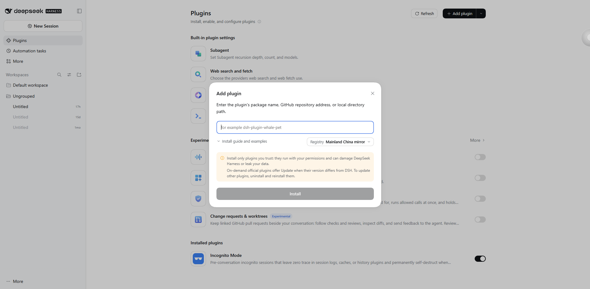
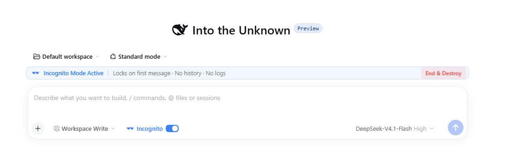

<div align="center">


# DeepSeek Harness 无痕浏览插件

**为 DeepSeek Harness（`dsh`）提供只存在于内存中的私密对话。**
不写入会话日志，不出现在历史记录里，离开即彻底消失。

`@local/dsh-incognito` · Host + Web Client 双端插件 · 无需修改 dsh 核心代码

[English](README.md) · **简体中文**

</div>

---

## 适用场景

有时你只是想随口问点什么，不希望它留在会话历史里、污染你的工作区；或者这是一次私密对话，你不希望它之后还能被检索到。本插件会在 DeepSeek Harness 中加入一个**无痕浏览**开关。在开始对话前打开它，这次对话就会：

- 🧠 **只存在于内存**：不写入会话日志、投影缓存或工作区存储
- 🙈 **不进入历史**：在侧边栏、会话列表、搜索以及 dsh 的历史/查询服务中都不可见
- 💥 **自动销毁**：结束、切走或关闭标签页后立即彻底删除，无法恢复

> [!IMPORTANT]
> 无痕浏览只保护 **dsh 自身的会话层**。某些其他插件仍可能读取或保存无痕对话的内容；模型服务商、Agent 工具、操作系统和浏览器则完全不在保护范围内。
> 在依赖它之前，请先阅读[失效场景](#失效场景)。

---

## 目录

- [安装](#安装)
- [使用方法](#使用方法)
- [实现原理](#实现原理)
- [失效场景](#失效场景)
- [项目结构](#项目结构)

---

## 安装

### 方式 A：在 DeepSeek Harness Web UI 中安装（推荐）



1. 打开 DeepSeek Harness Web UI，点击侧边栏中的 **Plugins（插件）**。
2. 点击 **Add plugin（添加插件）**。
3. 填入**本仓库的 GitHub 地址**，或本文件夹在本地的**目录路径**，然后点击 **Install（安装）**。
4. **Incognito Mode（无痕浏览）** 会出现在 **Installed plugins（已安装插件）** 中，确认它的开关已打开。

### 方式 B：使用命令行

在 DeepSeek Harness 仓库根目录下运行以下命令，并将本文件夹放在 `plugins/dsh-incognito/`。

**安装到 profile（长期生效）：**

```sh
pnpm dsh plugin --profile web add ./plugins/dsh-incognito
pnpm dsh web
```

**或仅在本次运行中挂载，不安装：**

```sh
pnpm dsh web --patch plugins/dsh-incognito/cordis.patch.yml
```

插件加载后，会注册 `/incognito` 命令和 `/api/incognito` 接口，并在 Web UI 中加入无痕浏览相关控件。

---

## 使用方法

### 规则

| | 规则 | 说明 |
| :-: | --- | --- |
| 1 | **开始前选择** | 只有在会话还是空白时，才能打开无痕浏览。 |
| 2 | **开始后锁定** | 发送第一条消息后，会话会一直保持无痕状态，不能再切回普通会话。 |
| 3 | **普通会话不能转无痕** | 已经以普通模式开始的对话，永远不能变成无痕对话。 |
| 4 | **离开即销毁** | 结束、取消、切换会话、新建会话，或关闭/刷新标签页，都会将其彻底销毁。 |
| 5 | **禁止分支** | 无痕会话不能 fork（分支复制）。 |

### 在 Web UI 中使用


1. **打开**：新建一个空白会话，打开输入框左下角的 **🕶️ 无痕浏览** 开关。
   在发送消息之前，你仍然可以把它关掉。
2. **对话**：输入框上方会出现一条提示横幅。发送第一条消息后开关锁定，会话打开期间，多轮对话的上下文照常保留。
3. **结束**：点击横幅或会话标题栏中的 **结束并销毁**，或者直接离开（切换会话、新建会话、关闭或刷新标签页）。
   随后会自动打开一个新的空白会话。

如果当前已经在进行普通对话，开关会显示为灰色且无法点击。

### 斜杠命令

| 命令 | 作用 |
| --- | --- |
| `/incognito`、`/incognito toggle` | 切换无痕浏览（仅限空白会话） |
| `/incognito on` | 打开；对话已开始时会被拒绝 |
| `/incognito off` | 关闭；无痕对话开始后会被拒绝 |
| `/incognito status` | 查看当前会话是否为无痕、是否已锁定 |
| `/incognito end`、`/incognito cancel` | 立即销毁当前无痕会话 |

执行 `/incognito` 本身不会在会话日志中留下记录，因此不会被视为对话已开始。

<details>
<summary><b>HTTP 接口：<code>/api/incognito</code></b></summary>

<br>

Web UI 通过这个接口工作，你也可以在脚本或测试中使用它。

| 请求 | 作用 |
| --- | --- |
| `GET /api/incognito?sessionId=<id>` | 查询状态：`exists`、`enabled`、`locked`、`destroyed`、`staged`、`workspaceId` |
| `POST { "sessionId", "action": "enable" \| "disable" \| "toggle" }` | 切换模式（仅限空白会话） |
| `POST { "sessionId", "action": "destroy", "reason" }` 或 `DELETE ?sessionId=<id>` | 销毁一个会话；不带 `sessionId` 时销毁所有无痕会话 |
| `POST { "action": "stage", "staged": true }` | 让*下一个*新建的会话从一开始就是无痕会话 |

出错时返回 HTTP `409` 和 `{ ok: false, code, message }`：

| 错误码 | 含义 |
| --- | --- |
| `incognito/conversation-already-started` | 尝试在对话中途打开无痕浏览 |
| `incognito/locked-after-start` | 尝试在无痕对话开始后关闭无痕浏览 |
| `incognito/session-not-found` | 会话不存在或已被销毁 |
| `incognito/forbidden-operation` | 尝试 fork 无痕会话 |
| `incognito/invalid-session`、`incognito/invalid-command-action` | 参数错误 |

</details>

<details>
<summary><b>插件 API：<code>ctx.incognito</code>（Host 端）</b></summary>

<br>

```js
await ctx.incognito.enable(sessionId)
await ctx.incognito.disable(sessionId)
await ctx.incognito.toggle(sessionId)
await ctx.incognito.destroy(sessionId, reason)   // 别名：cancel(sessionId)

ctx.incognito.getStatus(sessionId)
ctx.incognito.isIncognito(sessionId)             // 是否为活跃的无痕会话
ctx.incognito.isHidden(sessionId)                // 活跃中、创建中或销毁中
ctx.incognito.setStagedForNextSession(true)

const unsubscribe = ctx.incognito.subscribe((status) => { /* ... */ })
```

</details>

---

## 实现原理

插件不修改任何 dsh 源码，而是**在运行时包装 dsh 已有的 Cordis 服务**：对已挂载的服务用
`ctx.get` 获取，对之后才挂载的服务用 `ctx.inject` 监听，然后把其中部分方法替换成带保护的版本。
对普通会话，这些保护版本直接调用原方法，行为与之前完全一致。

插件分为两部分：

- **Host 端**（`index.js`）负责核心工作：隔离、拦截写入、销毁会话、`/incognito` 命令和 `/api/incognito` 接口。
- **Web Client 端**（`client.js`）负责界面，以及离开页面时的处理。

### 1. 记录无痕会话

- 所有活跃的无痕会话保存在一个内存中的 `Map` 里，这是会话处于无痕状态的**唯一记录**。
- 被销毁的 `Session` 对象会放入 `WeakSet`：仍持有旧引用的代码无法再向其写入，但对象依然可以被垃圾回收。
  **销毁后连会话 ID 都不会保留。**
- 创建中和销毁中的会话同样被隐藏，不会在列表中一闪而过。

### 2. 「开始前选择」与锁定

- 只有出现真正的对话事件（`turn/`、`step/`、`user/`、`assistant/`、`tool/`、`request/`，
  或排入下一轮的用户消息）时，会话即算*已开始*。
- 打开无痕浏览时会同时检查内存和磁盘，如果已存在对话，就会拒绝。
- 一旦出现第一条对话事件或发送了提示词，会话立即锁定，此后关闭无痕浏览会被拒绝。

### 3. 不写入磁盘

会话变为无痕时，插件会先**清理**空白会话已经产生的内容，再**拦截**之后的所有写入：

| 存储 | 打开时清理 | 之后拦截 |
| --- | --- | --- |
| 会话日志（`sessionPersistence`，JSONL/zstd） | 丢弃待写入数据、停用已打开的文件句柄、删除会话目录 | 新句柄只是内存中的空壳；批量写入、写头部、flush 都不生效 |
| 投影缓存（`sessionProjectionCache`） | 删除缓存快照和待执行的定时器 | 写入不生效；读取返回空 |
| 工作区（`workspaceRegistry`） | 把会话从工作区中移除（所属工作区只记在内存里） | 忽略挂载会话和记录路径的操作 |
| 工具输出溢出文件（`spillStore`） | — | 记录这些文件，在会话销毁时删除 |
| `session/flush` 事件 | — | 不派发给任何监听者 |

从无痕会话中启动的子 Agent 会话同样是无痕的。

### 4. 对历史与查询不可见

- **列表与搜索**：会话列表、已保存会话列表，以及 `sessionQuery` 的列表/筛选/搜索都会跳过无痕会话。
- **按 ID 查询**：`sessionQuery` 的各种读取（会话、事件、标题、追踪、观察）会抛出 dsh 自己的
  *未找到* 错误。错误由真实的错误类创建，调用方的 `instanceof` 判断依然有效。
- **`sessions.get`**：只把会话返回给需要运行它的 dsh 模块（Agent 循环、命令运行时、会话控制器）；
  查询、引用解析、日志导出、遥测和标题相关代码拿到的是 `undefined`。
- **事件**：无痕会话的事件只会送达 dsh 的内存投影，以及你当前页面的实时流，其他监听者收不到。
  「会话新增/活动/标题/遥测」事件会被屏蔽，同时发出「会话移除」事件，让侧边栏立刻去掉它。
- **fork** 会被拒绝。

你正在查看的页面仍然可以加载和接收这次对话：这些调用在执行期间会被标记为已授权。

### 5. 彻底销毁

以下任一情况都会销毁会话：

- 取消会话、执行 `/incognito end`、点击 **结束并销毁**，或调用 `DELETE /api/incognito`；
- 切换到其他会话，或新建会话；
- 正在接收已锁定会话的页面断开连接（有 150 毫秒缓冲）；
- 关闭或刷新浏览器标签页（通过 `navigator.sendBeacon` 发送）；
- 插件被卸载。

销毁过程：

1. 从插件的 Map 中删除该会话（不留任何「已删除」标记），并销毁它的子 Agent 会话；
2. 停止正在运行的 Agent 任务并清空其队列；
3. 清空内存中的事件日志、派生消息和界面节点；
4. 把会话从 dsh 的会话存储、Agent 注册表、投影和控制器中移除；
5. 再次执行磁盘清理，并删除工具输出溢出文件；
6. 通知界面该会话已消失。

此后任何恢复、打开或查询该会话的尝试都会返回*未找到*，就像它从未存在过。

### 6. 浏览器端

- 开关、横幅和 **结束并销毁** 按钮通过 Web UI 插槽加入（输入工具栏、输入框上方、会话标题栏），支持中英文。
- 浏览器端的会话列表会过滤掉无痕会话，所以它们不会出现在侧边栏中。
- 会话销毁时，所有包含其 ID 的 `localStorage` 键都会被删除，并在同一工作区打开一个新的空白会话。

---

## 失效场景

无痕浏览只保证 **dsh 自身的会话层**不留痕迹。它依靠在运行时包装特定服务来工作（见[实现原理](#实现原理)），
而 Cordis 在插件之间没有权限边界：同一进程里的所有插件都能看到并修改相同的对象。
任何不经过被包装方法的访问都不受保护。

> [!WARNING]
> 对于记忆插件，如果是在对话过程中调用插件记录对话历史（例如 MCP Reference Memory，或在每次调用模型前后自动记录的插件），或者直接读取内存（`ctx.sessions.store`、`session.log`）而不是通过公开方法（`ctx.sessions.list()`、`ctx.sessions.get(id)`、`ctx.sessionQuery.readSession(id)`）来读取会话数据，则无痕模式失效。

### 其他情况

这和插件是否可靠无关：一个合格的记忆插件可能按正常方式工作，也会把无痕对话保存下来。除上面两种情况外，以下场景也可能导致无痕模式失效：

1. **即使插件使用公开方法，也可能绕过保护。**
   例如插件比本插件先加载，并提前保存了原方法（`const get = ctx.sessions.get.bind(ctx.sessions)`）；或在本插件之后替换了同一个方法，而没有调用前一个版本。本插件替换的是服务对象上的方法，提前保存的副本或覆盖后的新方法都不受保护。是否发生取决于**插件加载顺序**，而添加、移除或调整插件都可能改变顺序。
2. **插件先缓存数据，之后才检查是不是无痕会话。**
   会话销毁后不留任何记录，此时 `ctx.incognito.isHidden(id)` 返回 `false`，缓存的数据看起来就像普通会话的。
3. **插件创建子会话时没有设置 `parentSession`。**
   只有无痕会话的子会话才会自动成为无痕，其他会话会被正常保存到磁盘。
4. **插件读取的是新版 dsh 新增的服务或事件。**
   本插件只过滤[实现原理](#实现原理)中列出的服务，新增的数据来源默认不受保护。


### 永远不在保护范围内

无论安装了哪些插件，以下内容都不是本插件能保护的：

- **模型服务商**，以及中间的任何代理或网关：你的消息仍会照常发送过去。
- **Agent 工具的副作用**：写入或修改的文件、Shell 历史、git 提交、网络请求、MCP 服务日志。
- **dsh 自身的日志**：调试/追踪日志和崩溃报告。
- **崩溃后残留的工具输出溢出文件**：它们只在会话销毁时删除，而且删除并不会覆盖磁盘上的数据。
- **操作系统**：交换文件/页面文件、休眠文件、崩溃转储、备份、云同步文件夹。
- **浏览器**：历史记录、HTTP/Service Worker 缓存、IndexedDB、`sessionStorage`（只清理了 `localStorage`）、扩展、剪贴板历史。
- **在会话进行中加载或卸载本插件**：卸载时不会还原被包装的方法，卸载时的销毁也不会等待完成。

### 给用户的建议

- 使用无痕浏览时，停用会读取或保存对话的插件，或使用精简的 profile。
- 尤其要留意**记忆、摘要、搜索/索引、统计分析、同步和备份**类插件。
- 添加、移除或调整插件之后，请假设保护效果可能已经改变。
- 不要用无痕浏览处理任何不能发送给模型服务商、或不能被 Agent 工具接触的内容。

### 让你的插件支持无痕浏览

如果你的插件会读取或保存对话数据：

```js
export const inject = { optional: ['incognito'] }

ctx.on('session/event', (session, event) => {
  // 在获取数据时立即检查，不要延后：会话销毁后不留任何痕迹。
  if (ctx.incognito?.isHidden(session.id)) return
  queue.push({ sessionId: session.id, event })
})
```

- 使用 `isHidden`（同时覆盖创建中和销毁中的会话），而不仅仅是 `isIncognito`。
- 在无痕会话中读取已有的记忆没有问题，但**不要写入任何新内容**：不生成摘要、向量、推断出的偏好，
  也不执行 Agent 调用的「保存记忆」工具。
- 不要在 `apply` 中保存服务的原方法，也不要读取 `ctx.sessions.store` 等内部状态。
- 用 `ctx.incognito.subscribe()` 在会话状态变为 `destroyed` 时清除内存中的数据。

---

## 项目结构

```text
dsh-incognito/
├── package.json       # 插件清单：Host 导出、Web Client 包、使用的客户端服务
├── cordis.patch.yml   # 用于 `dsh web --patch` 的补丁
├── index.js           # Host 端：隔离、拦截写入、销毁、/incognito、/api/incognito
├── client.js          # Web Client 端：开关、横幅、结束并销毁、侧边栏过滤、自动销毁
├── icon.svg           # 插件图标
├── docs/
│   ├── install-from-web-ui.png   # 截图：在 Plugins 页面安装插件
│   └── incognito-switch.png      # 截图：无痕浏览开关和提示横幅
└── locale/
    ├── en.json        # 英文名称与描述
    └── zh.json        # 中文名称与描述
```
